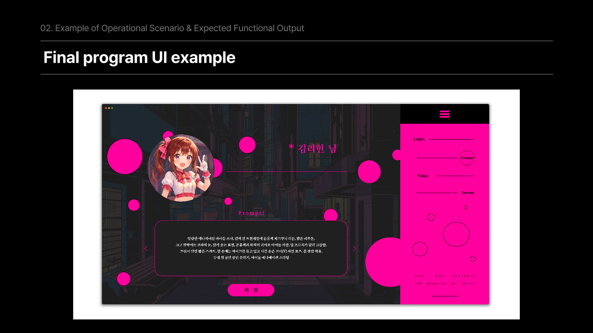
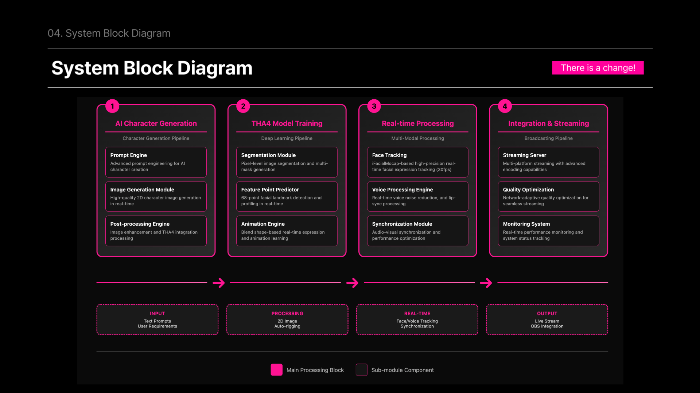
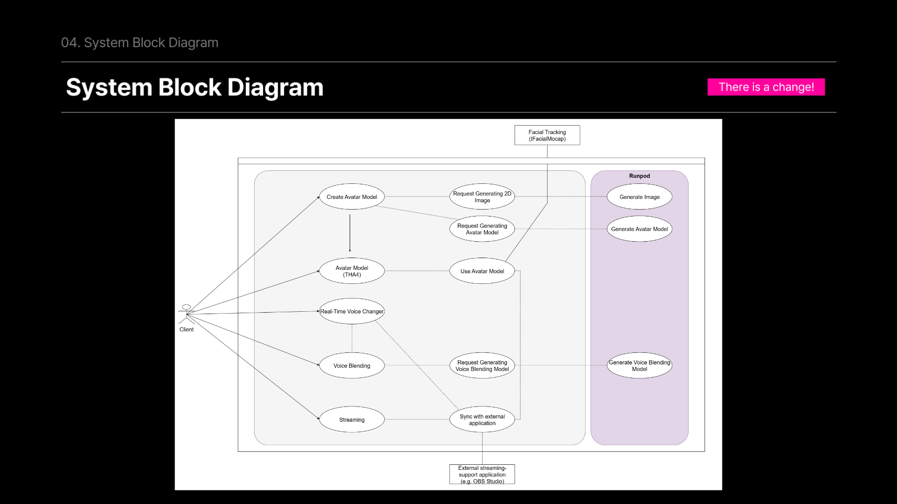
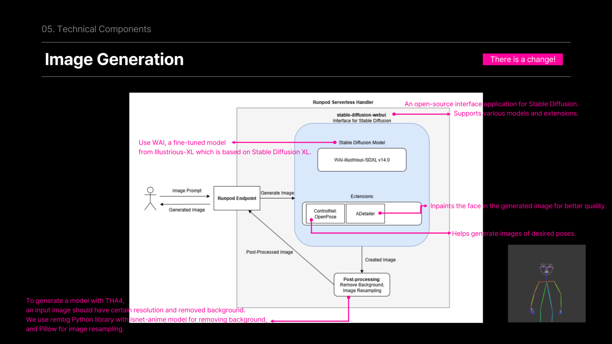
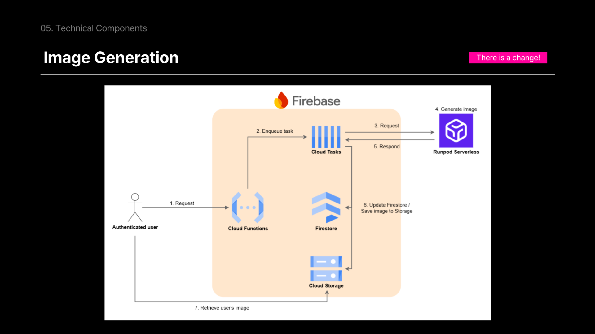
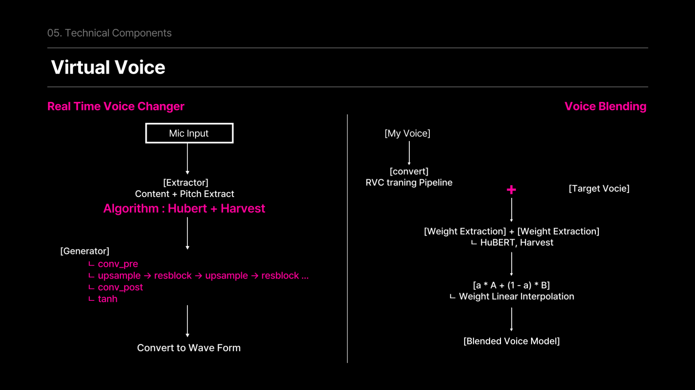
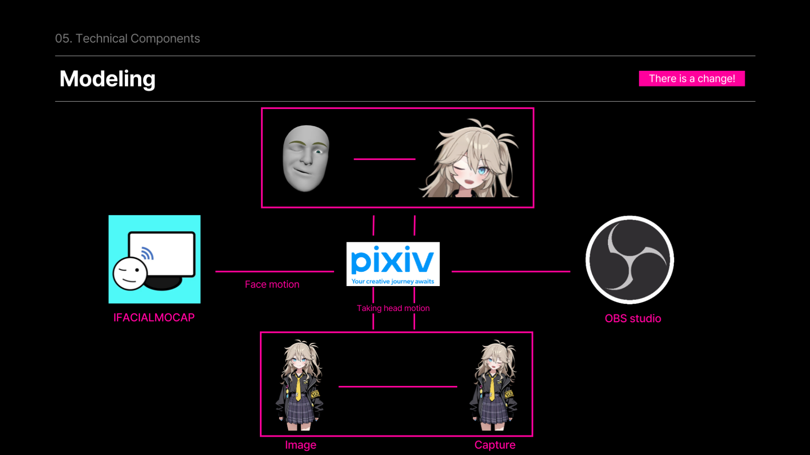

# 도전! 버튜버 | AI VTuber 통합 플랫폼

**아바타 이미지 생성부터 캐릭터 모델 준비, 음성 변조와 방송 연동까지 연결하는 데스크톱 프로젝트입니다.**

사용자가 원하는 캐릭터를 텍스트로 입력하면 이미지를 생성하고, THA4 기반 캐릭터 모델과 표정 이미지를 준비합니다. 여기에 RVC 음성 모델 학습·블렌딩과 iFacialMocap 기반 표정 제어를 결합해 자신만의 가상 캐릭터로 방송할 수 있는 환경을 구성합니다.

[발표자료 PDF · 35페이지](docs/presentation/AI_VTUBER_발표자료.pdf) · [설치·실행 가이드](docs/SETUP.md) · [음성 API 구현](backend/main.py)



> 발표자료의 서비스 설계와 이 저장소의 구현을 함께 정리했습니다. 화면 이미지는 발표자료의 예시이며, Firebase 서버 함수와 Runpod 워커는 별도 배포 영역입니다.

## 프로젝트 배경

가상 캐릭터로 콘텐츠를 만들려면 캐릭터 제작·리깅, 음성 변조, 얼굴 추적과 방송 프로그램을 각각 준비해야 합니다. 이 프로젝트는 이러한 준비 과정을 하나의 앱에서 연결해, 얼굴을 직접 드러내지 않고도 원하는 모습과 목소리로 자신을 표현할 수 있도록 기획했습니다.

핵심은 **캐릭터를 만드는 과정과 방송에서 사용하는 과정을 연결하는 것**입니다. 이미지·음성 학습처럼 시간이 걸리는 작업은 클라우드 GPU에 요청하고, 앱은 결과를 불러와 표정 제어 및 방송 도구와 연동합니다.

## 주요 기능

| 기능 | 내용 |
| --- | --- |
| 사용자 인증 | Firebase 이메일·비밀번호 및 Google 로그인 |
| AI 아바타 생성 | 텍스트 프롬프트로 이미지 생성 요청, 최신 결과 조회·다운로드 |
| THA4 캐릭터 모델 | 생성한 이미지를 바탕으로 모델 생성 요청, 상태 확인·취소·다운로드 |
| 음성 모델 준비 | 음성 파일 업로드, WAV 변환, 원격 학습 연계, `.pth`·`.index` 조회 |
| 음성 모델 블렌딩 | 호환되는 두 RVC 모델의 가중치를 지정 비율로 결합 |
| 실시간 표정 제어 | iFacialMocap UDP 입력을 아바타 표정에 매핑하고 OBS 창 캡처와 연동 |

## 시스템 디자인

### 전체 설계

전체 흐름은 **캐릭터 생성 → 모델 준비 → 실시간 제어 → 방송 연동**으로 나뉩니다. 앞단에서는 이미지와 모델을 만들고, 실행 단계에서는 준비된 결과를 사용자 입력과 연결합니다.



### 구성요소와 책임

| 구성요소 | 맡은 역할 | 주요 코드·자료 |
| --- | --- | --- |
| Electron 앱 | 로그인·기능 화면, Python 도구와 음성 학습 창 실행 | [main.js](src/tha4/app/main.js), [renderer.js](src/tha4/app/renderer.js) |
| Firebase 클라이언트 | 인증, 이미지·모델 생성 함수 호출, 결과 경로 조회 | [login-logic.js](src/tha4/app/login-logic.js), [image_model.js](src/tha4/app/image_model.js) |
| React 음성 UI | 파일 업로드, 모델 목록·다운로드, 블렌딩 입력 | [voice_train/src](src/tha4/app/voice_train/src) |
| FastAPI 음성 서버 | WAV 변환, S3 입출력, 원격 학습 요청, 모델 블렌딩 | [backend/main.py](backend/main.py) |
| Runpod GPU 환경 | 이미지 생성 및 모델 학습을 수행하는 외부 실행 환경 | [runpod_client.py](src/runpod_client.py), 발표자료 |
| THA4·Python 도구 | 캐릭터 모델 처리, 표정 이미지 준비, 모캡 입력과 표정 매칭 | [fmpm.py](src/tha4/app/fmpm.py), [absolute.py](src/tha4/app/absolute.py) |
| 저장소 | Firebase에는 이미지·캐릭터 모델 경로, S3에는 음성 입력과 모델 산출물 관리 | [image_model.js](src/tha4/app/image_model.js), [s3_utils.py](src/s3_utils.py) |

이미지·캐릭터 경로는 Firebase를, 음성 경로는 FastAPI와 S3를 사용합니다. 두 흐름을 하나의 저장소나 하나의 인증 처리로 가정하지 않고 각 데이터 계약을 구분했습니다.

<details>
<summary>발표자료의 사용자·외부 서비스 연결도</summary>



이 그림은 서비스 전체 설계입니다. 현재 저장소의 로컬 음성 블렌딩 구현은 FastAPI 프로세스에서 실행됩니다.

</details>

## 기능별 처리 과정

### 1. 프롬프트에서 아바타 이미지까지

1. 로그인한 사용자가 캐릭터 특징을 프롬프트로 입력합니다.
2. 앱이 Firebase callable 함수 `generate_image`에 생성 요청을 보냅니다.
3. 발표 설계에서는 Cloud Functions와 Cloud Tasks를 통해 Runpod GPU 작업으로 연결합니다.
4. 이미지 생성 후 배경 제거와 크기 조정을 거쳐 캐릭터 모델 입력을 준비합니다.
5. 결과 파일은 Storage에 저장하고, Firestore 사용자 문서의 `imagePath`로 최신 결과를 참조합니다.

발표자료의 이미지 생성 파이프라인은 **WAI-illustrious-SDXL, ControlNet OpenPose, ADetailer**를 사용하고, `rembg`의 `isnet-anime`과 Pillow로 후처리하는 구성입니다. 클라이언트 연결 코드와 GPU 워커 내부 설계를 구분해 소개합니다.



<details>
<summary>비동기 요청·결과 저장 구조</summary>

생성 요청의 접수와 결과 수신을 분리한 설계입니다. 사용자는 먼저 요청을 제출하고, 생성 이후 저장된 결과를 조회합니다.



현재 저장소에는 callable 함수를 호출하고 결과를 읽는 클라이언트가 있으며, Cloud Tasks와 생성 서버 함수 본문은 별도 배포 대상입니다.

</details>

### 2. 생성 이미지에서 캐릭터 모델까지

이미지가 준비되면 앱은 Firestore에서 최신 `imagePath`를 읽어 `generate_tha4_model`에 전달합니다. 사용자는 `check_runpod_pod`로 작업 상태를 확인하거나 `cancel_runpod_pod`로 취소를 요청하고, 완료 결과는 `tha4ModelPath`를 통해 다운로드합니다.

이후 THA4 기반 도구로 표정·머리 방향의 조합에 해당하는 PNG를 미리 준비합니다. 실시간 실행 경로에서는 이 이미지들을 인덱싱하고 모캡 값에 가까운 표정을 선택합니다. **모델 준비 단계와 실시간 표정 선택 단계를 분리한 구조**입니다.

### 3. 음성 파일에서 RVC 모델까지

음성 경로는 다음 순서로 구성됩니다.

```text
음성 파일 선택
  → FastAPI 업로드
  → ffmpeg로 WAV 변환
  → S3 사용자별 입력 경로 저장
  → 외부 학습 서버 알림 또는 별도 /train 요청
  → 모델 산출물(.pth / .index) 조회·다운로드
```

- `/upload`, `/upload-multiple`은 파일을 저장한 뒤 외부 학습 서버에 알림을 예약합니다.
- `/train`은 별도의 Runpod Serverless 제출 경로이며, 입력·출력 S3 경로와 학습 옵션을 전달합니다.
- `/models/files`로 산출물을 분류하고, 개별 파일 또는 ZIP 다운로드 경로를 제공합니다.

업로드 완료와 모델 학습 완료는 서로 다른 상태입니다. 현재 React 화면의 진행률은 모델 ZIP 다운로드 전송률이며, 학습 진행률을 의미하지 않습니다.

### 4. 음성 변조와 모델 블렌딩

발표자료에서는 마이크 입력에서 **HuBERT 기반 내용 특징과 Harvest 기반 피치**를 추출해 RVC 변환으로 이어지는 음성 처리 구조를 설명합니다. 실시간 음성 변환 실행 환경과 음성 모델을 준비하는 학습·블렌딩 API는 구분됩니다.



저장소의 블렌딩 구현은 두 `.pth` 체크포인트를 읽어 샘플레이트, 가중치 키와 텐서 크기를 비교한 뒤 다음 식으로 결합합니다.

```text
W_blend = α × W_A + (1 − α) × W_B
```

결과는 설정·샘플레이트·버전 등의 메타데이터와 함께 새 `.pth`로 저장합니다. 이는 **모델 가중치의 선형 보간**이며, 완성된 음원 파일을 섞거나 `.index` 파일을 병합하는 동작과는 구분됩니다.

구현: [src/model_blender/backend/logic.py](src/model_blender/backend/logic.py)

### 5. 얼굴 움직임에서 방송 화면까지

1. iFacialMocap이 보낸 UDP 데이터를 수신합니다.
2. 눈썹·눈 깜빡임·입 벌림·머리 방향 값을 읽고 평활화합니다.
3. 값을 이산 표정 인덱스로 바꿉니다.
4. 미리 생성한 PNG 중 같은 키 또는 가까운 조합을 선택합니다.
5. 초록 배경의 오버레이 창에 그려 OBS 창 캡처와 크로마키로 방송 화면에 합성합니다.



Live 메뉴는 [absolute.py](src/tha4/app/absolute.py)를 실행하며, 별도 오버레이 도구는 [overlay_window.py](src/tha4/app/overlay_window.py)입니다. 두 경로 모두 준비된 표정 PNG를 매칭하는 방식이며, 기본 이미지 폴더와 실행 방법은 [설치 가이드](docs/SETUP.md)에 구분했습니다.

## 데이터 구조

### Firebase: 사용자와 최신 생성 결과 연결

클라이언트는 `users/{Firebase UID}` 문서를 읽어 결과 파일을 찾습니다.

| 필드 | 의미 | 사용처 |
| --- | --- | --- |
| `imagePath` | 가장 최근에 생성된 이미지의 Storage 객체 경로 | 이미지 다운로드, THA4 모델 생성 요청 |
| `tha4ModelPath` | 생성된 캐릭터 모델의 Storage 객체 경로 | 모델 다운로드 |

이미지·모델 파일 자체와 참조 경로를 분리합니다. 클라이언트는 문서의 경로를 읽고 `getDownloadURL`로 파일에 접근하므로, Storage의 실제 객체 경로는 서버가 기록한 값에 따릅니다.

### S3: 음성 입력과 학습 산출물 분리

아래는 기본 설정과 `/train`이 전달하는 경로를 기준으로 한 예시입니다.

```text
voice_blend/
├── kenny/
│   └── uploads/
│       ├── kenny.wav
│       └── kenny_2.wav
└── models/
    └── kenny/
        └── run1/
            ├── model.pth
            └── model.index
```

| 항목 | 역할 |
| --- | --- |
| `user_id` | 음성 입력과 산출물을 묶는 식별자. 현재 서버는 영문자만 남겨 사용 |
| `run` | 학습 실행별 출력 경로 구분 |
| `.wav` | 모델 학습에 전달할 음성 입력 |
| `.pth` | RVC 모델 체크포인트 |
| `.index` | RVC에서 사용하는 검색 인덱스 산출물 |

Firebase UID와 음성 UI의 수동 `user_id`는 현재 코드에서 완전히 통합되어 있지 않습니다. 예시의 모델 파일명은 설명용이며 실제 산출물 이름은 원격 학습 워커에 따라 달라집니다.

### 학습 요청 데이터

`POST /train`의 JSON 예시입니다. 서버는 이를 S3 입력·출력 경로와 Runpod 작업 요청으로 변환합니다.

```json
{
  "user_id": "kenny",
  "run": "run1",
  "extra": {},
  "wait": false
}
```

`wait: false`이면 제출 결과와 `job_id`를 반환하고, `true`이면 작업 상태를 폴링한 결과를 반환합니다. 워커별 학습 옵션은 `extra`로 전달합니다.

### THA4 캐릭터 모델 파일

저장소의 예제 캐릭터 모델은 YAML이 이미지와 모델 가중치 파일을 연결합니다.

```text
character_model.yaml
character.png
face_morpher.pt
body_morpher.pt
```

```yaml
character_image_file_name: character.png
face_morpher_file_name: face_morpher.pt
body_morpher_file_name: body_morpher.pt
```

### 실시간 표정 검색 자료구조

표정 PNG의 파라미터를 다음 순서의 8요소 튜플로 만들어 파일 경로와 연결합니다.

```text
(EBL, EBR, EWL, EWR, JO, HX, HY, BL) → PNG 파일 경로
```

- `EBL`, `EBR`: 좌우 눈썹
- `EWL`, `EWR`: 눈 깜빡임·윙크 파라미터
- `JO`: 입 벌림
- `HX`, `HY`, `BL`: 머리 방향·기울기 관련 파라미터

정확히 같은 튜플이 있으면 바로 조회합니다. 없으면 눈·입·머리 방향으로 후보를 좁힌 뒤 거리 기준으로 가까운 이미지를 선택합니다. 이미지 캐시는 `OrderedDict`로 최근 사용 순서를 관리하고 최대 300장을 유지하며, 모캡 값은 파라미터별 최근 3개 샘플을 평균해 흔들림을 줄입니다.

이 구조는 **연속적인 얼굴 입력을 제한된 표정 조합으로 변환해, 준비된 이미지에서 빠르게 선택하는 방식**입니다.

## 코드 구조

```text
AI_VTUBER/
├── backend/main.py                 # 음성 업로드·학습 요청·산출물·블렌딩 API
├── src/
│   ├── config.py                   # 환경 설정
│   ├── s3_utils.py                 # 음성·모델 객체 입출력
│   ├── runpod_client.py            # GPU 작업 제출·상태 확인
│   ├── model_blender/backend/logic.py
│   └── tha4/
│       ├── distiller/              # THA4 모델 준비·학습 도구
│       ├── poser/                  # 캐릭터 포즈 처리
│       └── app/
│           ├── main.js             # Electron 프로세스·기능 실행
│           ├── renderer.js         # 메인 화면 이벤트 연결
│           ├── login-logic.js      # Firebase 인증
│           ├── image_model.js      # 이미지·캐릭터 모델 callable 연결
│           ├── fmpm.py             # 표정 PNG 사전 생성
│           ├── absolute.py         # Live 메뉴의 모캡·표정 제어
│           ├── overlay_window.py   # 별도 오버레이 도구
│           └── voice_train/        # React 음성 업로드·모델 UI
├── voice_changer_UI/               # 음성 변환 UI·설정
├── data/character_models/          # 예제 캐릭터와 모델 설정
└── docs/                           # 실행 문서와 발표 PDF
```

## 음성 API

[backend/main.py](backend/main.py)에 정의된 API입니다. Firebase callable 함수와는 별도의 로컬 FastAPI 경로입니다.

| Method | 경로 | 역할 |
| --- | --- | --- |
| GET | `/` | 서버 상태 |
| GET | `/health` | S3 연결 및 임시 객체 입출력 확인 |
| POST | `/upload` | 음성 파일 한 개 업로드·WAV 변환 |
| POST | `/upload-multiple` | 여러 음성 파일 업로드·WAV 변환 |
| POST | `/train` | Runpod 학습 작업 제출 |
| GET | `/models/indexes` | 사용자별 `.index` 목록 |
| GET | `/models/files` | 사용자별 `.pth`·`.index` 목록 |
| GET | `/models/download` | 모델 파일 다운로드 |
| GET | `/models/presign` | 모델 다운로드 URL 발급 |
| GET | `/models/archive` | 사용자 모델 파일 ZIP 구성 |
| POST | `/blend/local` | 두 `.pth` 모델 블렌딩 |
| GET | `/blend/download` | 블렌딩 결과 다운로드 |

## 개발 과정과 평가 방향

발표 일정은 이미지·모델 생성과 음성 변조 기능부터 시작해 자동 리깅, 백엔드, 사용자 앱을 연결하는 순서로 구성되어 있습니다. 기능별 도구를 만드는 과정과 이들을 하나의 앱에서 호출하고 결과를 전달하는 통합 과정을 함께 다뤘습니다.

| 단계 | 주요 작업 |
| --- | --- |
| 생성 파이프라인 | 프롬프트 입력, 이미지 생성·후처리, 캐릭터 모델 준비 |
| 음성 기능 | 입력 파일 정리, 원격 학습 연결, RVC 모델 변조·블렌딩 |
| 실시간 제어 | 모캡 값 변환, 표정 조합 준비·검색, 오버레이 출력 |
| 앱 통합 | 인증, 사용자별 결과 조회, 기능 실행, OBS 연동 |

발표자료는 다음 평가 항목을 제시합니다.

- **음성 변환:** 입력부터 출력까지의 지연, PESQ 기반 음질, STOI 기반 명료도
- **음성 블렌딩:** 입력이 달라져도 음색이 유지되는지에 대한 출력 안정성
- **아바타 생성:** CLIP 기반 프롬프트·이미지 일치도
- **리깅:** 얼굴 랜드마크와 표정 반영 결과 비교

PDF의 비용·ROI·성능 비교표는 발표 당시 가정과 비교 조건을 포함한 자료입니다. 여기서는 이를 현재 환경에서 재현한 성능이나 보장 수치로 제시하지 않습니다.

## 팀 구성과 역할

발표자료 32페이지의 역할 분담을 기준으로 정리했습니다.

| 팀원 | 담당 역할 |
| --- | --- |
| 방문혁 | AR 연동, 이미지 자동 리깅, iPhone 호환 |
| 한승호 | 이미지 리깅 모델 튜닝, 서버 구현 |
| **조현석** | **음성 변조, 서버 구현** |
| 김리현 | UI 개발, LLM 모델 학습 |

## 설치와 추가 자료

설치·환경 설정·기능별 실행 및 문제 해결은 [설치·실행 가이드](docs/SETUP.md)에 정리했습니다.

- [발표자료 PDF · 35페이지](docs/presentation/AI_VTUBER_발표자료.pdf)
- [Firebase UID 사용 가이드](src/tha4/app/UID_사용법.md)
- [아바타 생성 상세 가이드](src/tha4/app/avatar/avatar_사용법.md)
- [THA4 모델 준비 문서](docs/distill.md)
- [라이선스](LICENSE)

THA4 기반 코드와 예제 자산의 원저작권·이용 조건은 저장소의 LICENSE 및 각 자산에 포함된 고지를 따릅니다.
